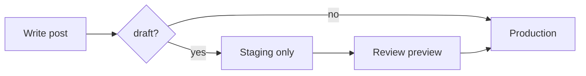
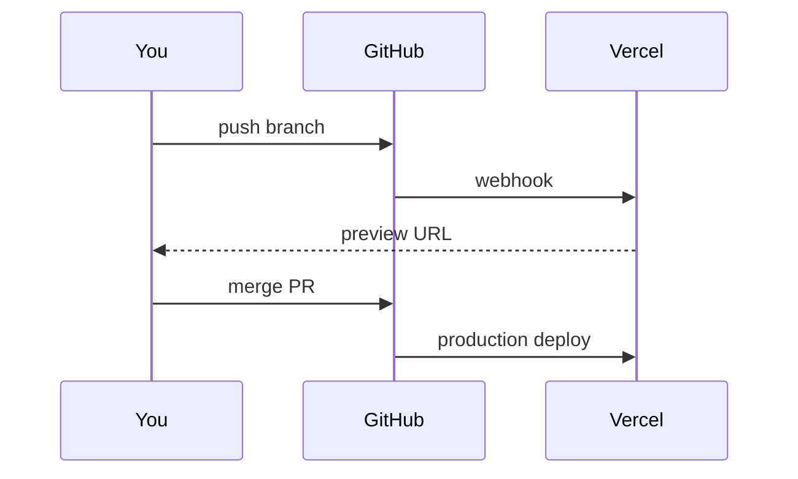

This post is a **draft**, so it only exists on staging (Vercel preview deployments) and on the local dev server. Production never builds it. Use it to check typography, media, diagrams and navigation after a design change.

Jump straight to [the diagrams](#diagrams) or [the links section](#links) to test in-page navigation.

## Text

A normal paragraph with **bold**, _italic_, ~~strikethrough~~ and `inline code`. Line length, line height and contrast should feel comfortable for long reading; this sentence is deliberately long so it wraps across the full width of the column on a desktop screen.

> A blockquote. Good for pulling out a quote or an aside that deserves a little more weight than the surrounding text.

### Lists

- An unordered item
- Another item with `code`
  - A nested item
- A final item

1. First step
2. Second step
3. Third step

- [x] A finished task
- [ ] An open task

### Table

| Service   | Language   | p99 latency |
| --------- | ---------- | ----------: |
| gateway   | Go         |       12 ms |
| billing   | TypeScript |       38 ms |
| reporting | Python     |      210 ms |

## Code

```ts
type Post = { slug: string; title: string; draft: boolean };

export function visible(posts: Post[], isProduction: boolean): Post[] {
  return isProduction ? posts.filter((post) => !post.draft) : posts;
}
```

```bash
bun run new-post "My next post"
bun run check:content
```

```sql
select slug, title from posts where draft = false order by date desc;
```

## Media

### Image with a caption

The text in quotes after the URL becomes the caption.


### Image without a caption


### SVG

SVG files work exactly like images, so a diagram exported from Excalidraw, Figma or draw.io can go in as an `.svg`. It stays sharp at any size.


### Video file

Use image syntax with a `.mp4` or `.webm` file. The alt text becomes the caption.


### YouTube embed

Use image syntax with a YouTube or Vimeo link. It loads from `youtube-nocookie.com`.


## Diagrams

Write a fenced code block with the language `mermaid`. The library loads only on pages that have a diagram.





## Links

- In-page: [back to Text](#text) stays on this page and scrolls.
- Same site: [all writing](/) and [the hello post](/hello-world) open in the same tab.
- Portfolio: [mathewsshaji.com](https://mathewsshaji.com) opens in the same tab.
- External: [MDN](https://developer.mozilla.org) opens in a new tab.
- Force a new tab: [all writing in a new tab](/ "newtab:")
- Force the same tab: [GitHub in this tab](https://github.com "sametab:")

Hover a section heading to see its `#` link; copy it to share a link to that section.

## Footnotes

Footnotes work too.[^1]

[^1]: This is the footnote text, shown at the bottom of the post.

---

End of the test post.
